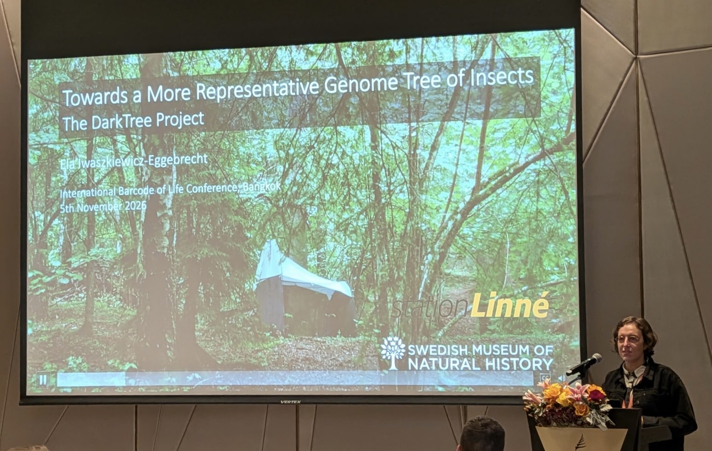
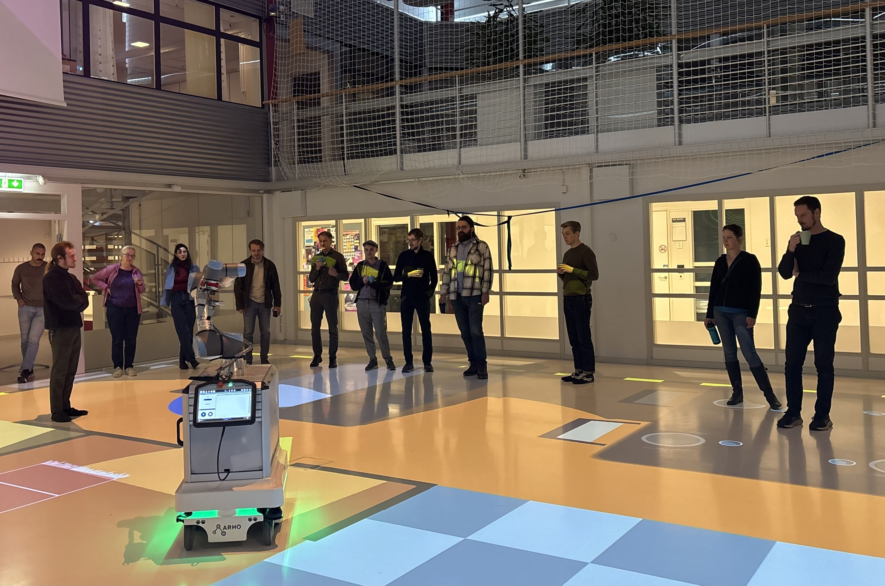
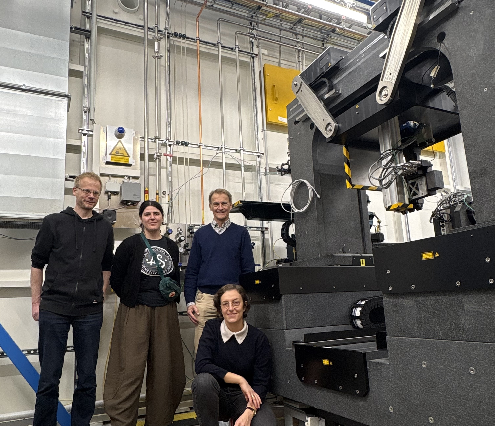
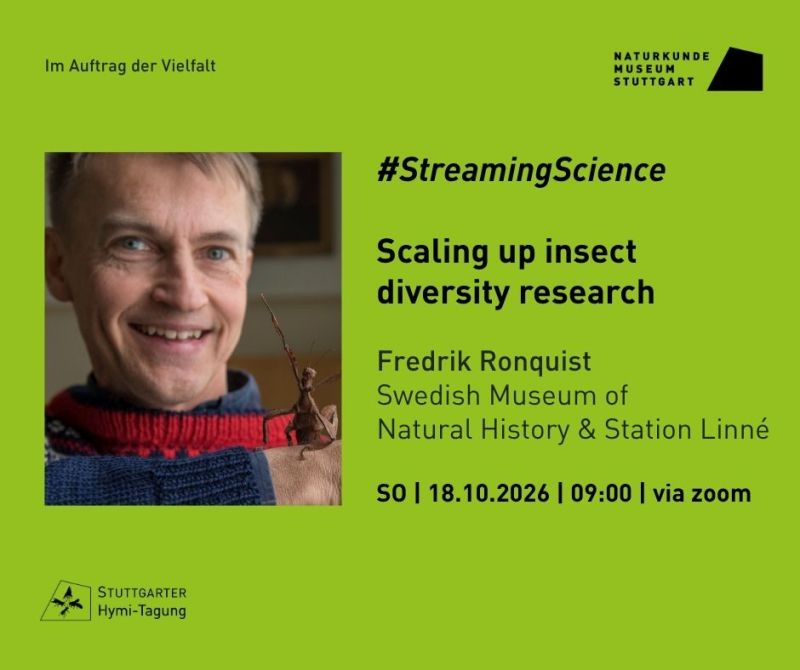
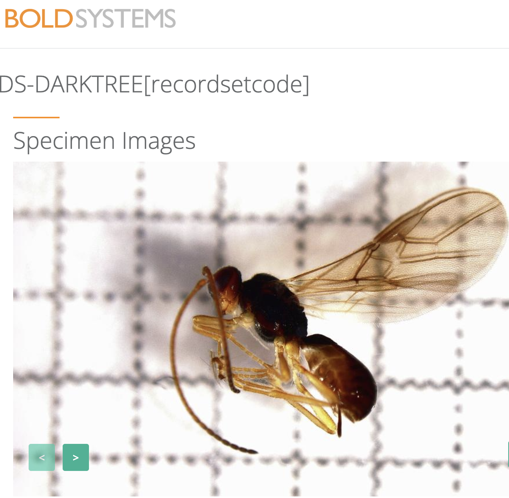
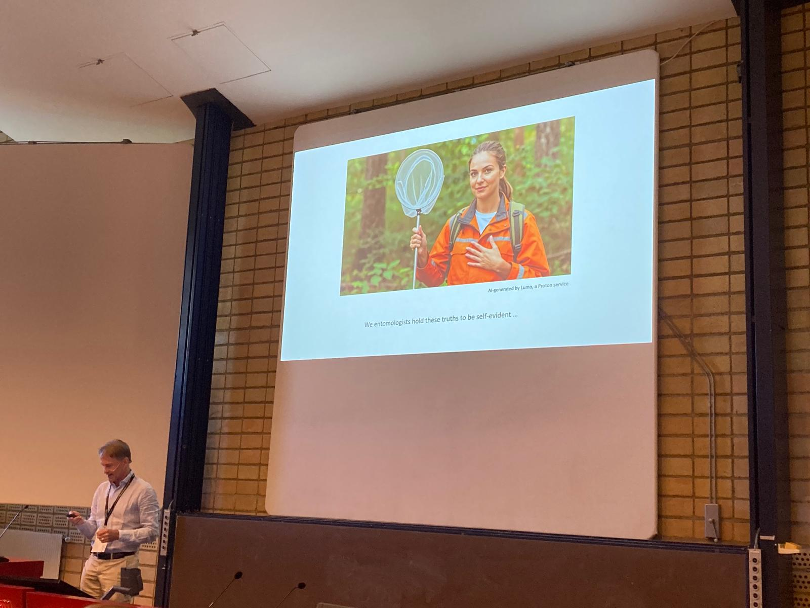
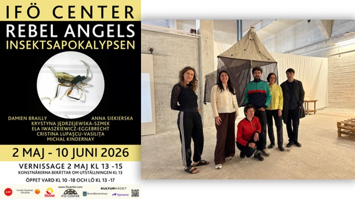
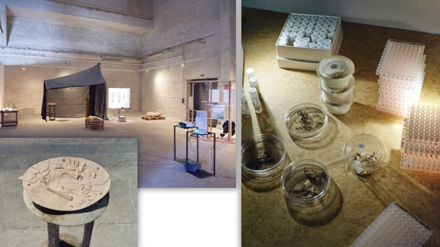
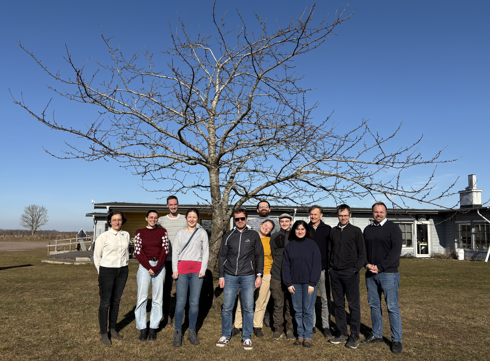
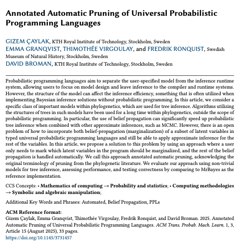

# News

### November 2026
Ela presented the DarkTree project at the International Barcode of Life Conference in Bangkok, Thailand, in the session “Revealing Dark Taxa”.

The presentation sparked considerable interest and highlighted the growing international effort to shed light on the lesser-known, or “dark”, part of biodiversity. A large research community is working to uncover and document this hidden diversity, and DarkTree is proud to contribute to this exciting frontier.

*Ela Iwaszkiewicz-Eggebrecht representing the project at iBOL conference in Bangkok.*

### October 2026 part 3
The DarkTree team met at Linköping University to discuss project progress, share knowledge, and learn from each other's areas of expertise.

Interdisciplinary collaboration takes time and effort: developing a common language and understanding across different fields is essential – and it's the most fun!

During the meeting, we dived into the details of DNA sequencing and PCR reactions and explored the fascinating world of insect diversity – meaning our computer scientists and engineers can now confidently recognize some of the major insect orders. Most importantly, we delved into Linköping University's area of expertise: computer vision.

An engaging and highly educational meeting, full of knowledge sharing and new perspectives!

*The group appreciating state-of-the-art robotics lab.*

### October 2026 part 2
Fredrik and Ela met with our German DarkTree collaborators, Cristina Vasilita-Lupascu and Thomas van der Kamp, experts in high-resolution micro-CT imaging of tiny insects using synchrotron radiation.

During their visit, they toured two synchrotron facilities operated by KIT in Karlsruhe and DESY in Hamburg, where DarkTree specimens are being scanned. The visit offered a fascinating insight into the technology behind the project and the opportunity to see how these advanced techniques reveal insect morphology in unprecedented detail.

A great opportunity to connect, exchange ideas, and see the science behind DarkTree in action!

*Four biologists keen on making use of the synchrotron for insect research.*

### October 2026 part 1
Fredrik talked about scaling up insect diversity research at Hymenoptera Days, organized by the State Museum of Natural History in Stuttgart. It was a fantastic conference and we are thankful to the organizers. The talk was recorded and can be viewed [here](https://www.youtube.com/watch?v=WIhODP9HEFQ).

### September 2026 
DarkTree has uploaded its first batch of 792 specimen images and barcodes to BOLD. 
This marks an important step in making our data accessible to the wider scientific community. BOLD provides a global platform for storing and sharing DNA barcode data, supporting species identification, biodiversity research, and future studies.
Check our growing dataset [here](https://portal.boldsystems.org/result?query=DS-DARKTREE%5Brecordsetcode%5D).

*DarkTree proejct on BOLD.*

### August 2026 

*Fredrik Ronquist talked about the DarkTree at the Biosystematics Conference in Uppsala (BioSyst2026).*

### May 2026 

Part of the DarkTree team contributed to the scientific-artistic exhibition bringing together art and insect research in response to the global biodiversity crisis. Centering on insects as both ecological indicators and cultural symbols, the project examined how science and art can jointly engage with questions of environmental change and coexistence.

### March 2026 

*Annual project retreat on Öland. Discussions, presentations and hands-on workshops.*

### February 2026 
Viktor Palmkvist received the best poster award at the inauguration of the Department of Computing and Learning Systems. Title: “Reactive Graphs for Efficient Markov Chain Monte Carlo Inference”

### August 2025

New research article on how to make probabilistic tree inference more efficient. Title “Annotated Automatic Pruning of Universal Probabilistic Programming Languages”, published in ACM Transactions on Probabilistic Machine Learning, Volume 1, Issue, https://dl.acm.org/doi/full/10.1145/3731457.

### March 2025

*Project kick-off meeting on Öland. DarkTree team meets in person for the first time.*

